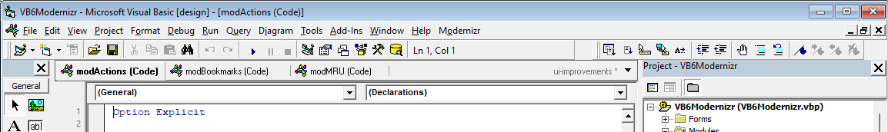
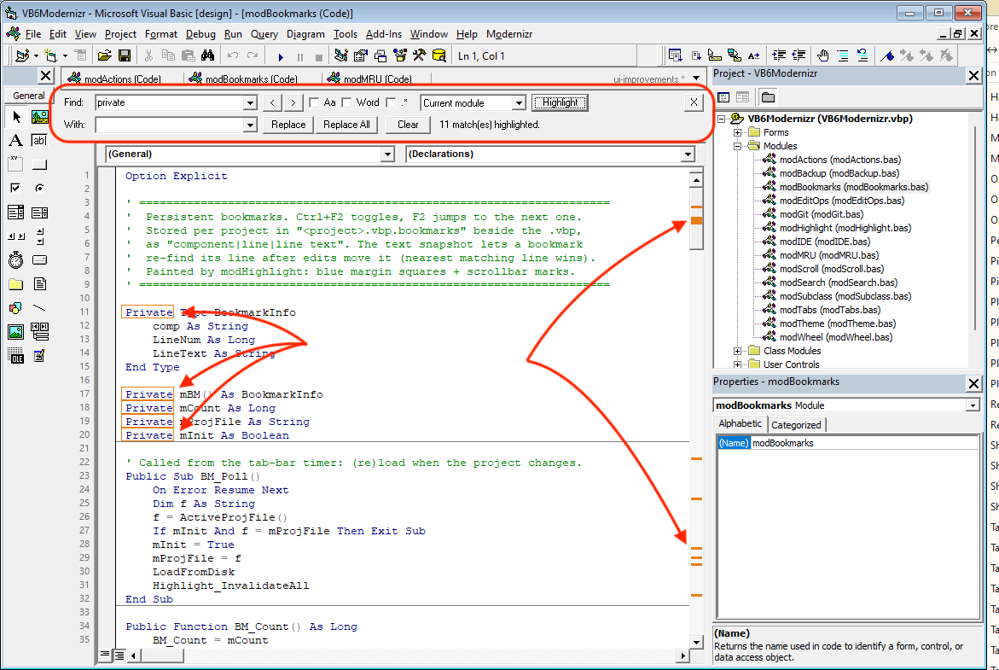
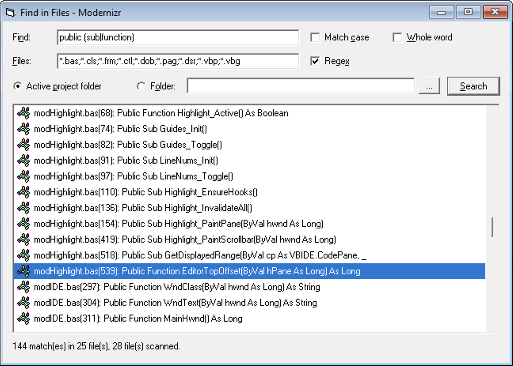
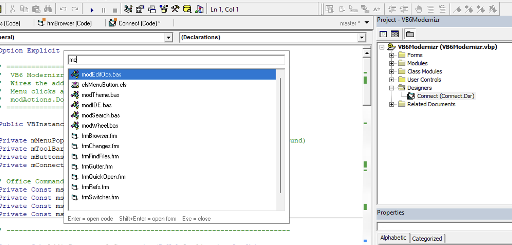
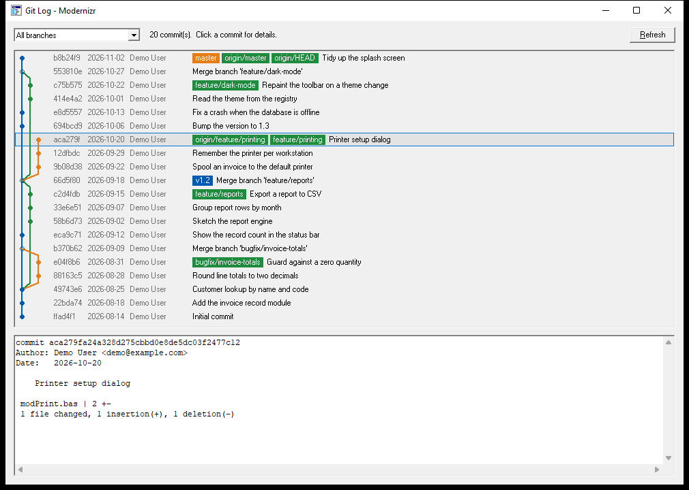
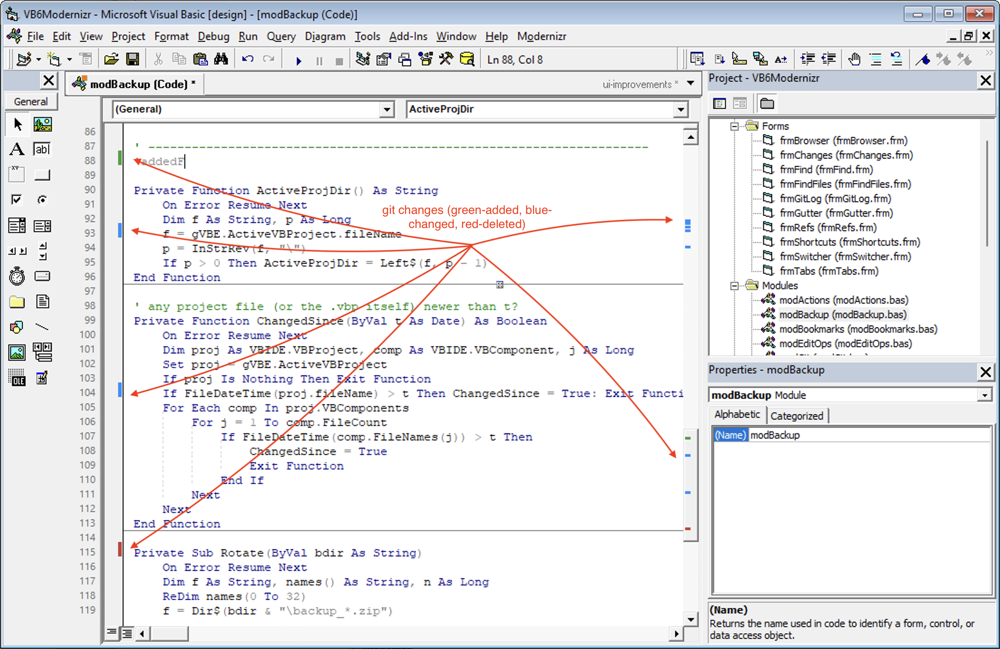
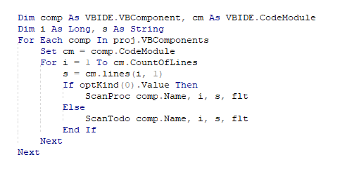
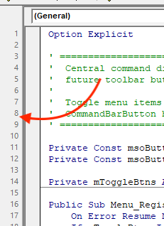
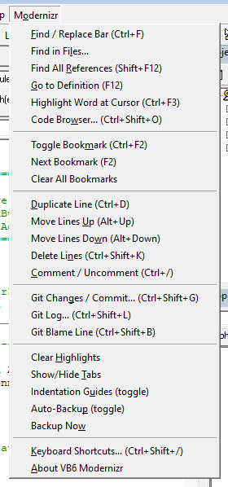
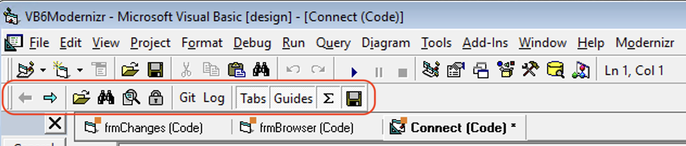

# VB6 Modernizr

A Visual Basic 6 IDE add-in, written in VB6 itself, that brings modern
editor conveniences to the classic IDE. No external dependencies:
everything uses the VB6 runtime, the extensibility library that ships
with VB6, Win32, and components present on every Windows install
(`VBScript.RegExp` for regex, `git.exe` on PATH for the git features,
PowerShell for backup zips).

## Features

### Window tabs
Browser-style tab bar above the code/designer area, drawn in the
classic VB6 3D look. Left click activates (windows are kept maximized
while tabs are on), middle click closes, drag reorders, right click
offers Close / Close Others / Close All / Copy Full Path / Open
Containing Folder. Tabs show the file's shell icon, a `*` for unsaved
changes, and an orange badge on the icon corner when the file is
modified vs git HEAD. The `▼` button lists every window when tabs
overflow; the right end shows the current git branch (`master *` when
dirty).



### Find / replace bar
A VS-style bar docked above the code area (Ctrl+F, prefilled from the
selection). Match case / whole word / regular expressions (with `$1`
group references in replacements); scopes: current module, selection,
open modules, whole project. Enter/Shift+Enter and F3/Shift+F3
navigate; Esc closes. **Highlight** outlines every match in the editor
and marks it on the vertical scrollbar (orange).



### Find in Files
Scans the codebase on disk — including designer sections of
`.frm`/`.ctl`/`.dsr` and project files — under the project folder or
any folder. Results show file icons; double-click jumps to the exact
line (header offset compensated); files outside the loaded project
group open in Notepad.



### Navigation
Go to Definition (F12; several candidates open a results list),
Find All References (Shift+F12), Highlight Word at Cursor (Ctrl+F3),
persistent bookmarks (Ctrl+F2 toggle / F2 next; blue margin squares +
scrollbar marks; stored in `<project>.vbp.bookmarks` beside the .vbp
and re-anchored after edits via a line-text snapshot), a Code Browser
of procedures/TODOs with live filter (Ctrl+Shift+O), a Quick Open
palette (Ctrl+P) that fuzzy-matches every module/file in the project
group as you type — capital-hump style, so `ms` finds modSubclass and
`ff` finds frmFindFiles; Enter opens the code window, Shift+Enter the
designer — and a Ctrl+Tab MRU window switcher (hold Ctrl, Tab cycles,
release commits) showing file icons and an orange dot on git-modified
files. Result lists use custom-drawn controls with shell file icons
throughout.



### Editing shortcuts
Duplicate line (Ctrl+D), move lines up/down (Alt+Up/Down), delete
lines (Ctrl+Shift+K), comment/uncomment (Ctrl+/). All work on the
selection, excluding a trailing line the selection only touches at
column 1 (VS convention).

### Git
Repo auto-detected from the project folder; everything shells out to
`git.exe` asynchronously (hidden process, output polled by a timer),
so the IDE never blocks. Status refreshes every ~5 s.

- **Switch branch** (Modernizr ▸ Switch Branch, the toolbar's
  *Branch* button, or a click on the branch name in the tab bar):
  type-to-filter list of local branches, most recently committed
  first, then the remote-tracking ones; picking a remote branch
  creates a local branch tracking it. The checkout is followed by a
  full project reload - see [Switching branches](#switching-branches)
  for why, and for what the add-in refuses to do.
- **Changes window** (Ctrl+Shift+G): staged/unstaged lists (file
  icons, multi-select) with stage/unstage selected or all; Commit
  commits the staged set; double-click opens the file. Selection and
  scroll position survive the background status refresh.
- **Log** (Ctrl+Shift+L): commit graph drawn by the add-in — colored
  branch lanes, rings for merges, branch/tag/HEAD chips — with
  hash/date/author/subject columns; click a commit for its message +
  diffstat. The scope box picks whose history to draw - any one
  branch, local or remote-tracking, or every branch at once - and
  opens on the branch that is checked out.
- **Blame** (Ctrl+Shift+B): commit/author/date/summary for the
  current line.
- **Changed-line markers**: margin bars (green = added, blue =
  modified, red = deletion below) and scrollbar marks, computed from
  `git diff -U0` against HEAD. Reflects the *saved* file.





### Extras
- **Mouse wheel scrolling** in code windows (Shift+wheel horizontal) —
  no need for Microsoft's separate MouseWheel fix.
- **Indentation guides** (menu toggle, default off): dotted vertical
  lines per indent step, bridging blank lines.



  
- **Line numbers** (menu toggle, default off): a real gutter strip is
  reserved left of the editor for maximized windows; floating windows
  fall back to small numbers in the indicator margin. These are
  code-module line numbers — the same numbering the IDE reports in
  error messages — not file lines (the designer block and `Attribute`
  headers only exist on disk, the editor never shows them).

  
  
- **Auto-backup** (menu toggle, default on): every 10 minutes, if
  project files changed, zips the project folder to
  `.backups\backup_<timestamp>.zip` (keeps the last 20) via a hidden
  PowerShell Compress-Archive. "Backup Now" forces one.

### Discoverability
Every command sits in the **Modernizr** menu with its shortcut in the
caption; on/off commands (tabs, guides, line numbers, auto-backup)
show a check mark reflecting their state. **Ctrl+Shift+/** opens a
keyboard cheat sheet.

A dockable **Modernizr toolbar** leads with **Back / Forward**
navigation, then the everyday commands (Quick Open, find bar, Find in
Files, Code Browser, git) plus the toggles, which render as pressed
buttons tracking their state. Clicking a window's button while that
window is open closes it again. Back/Forward walk the add-in's own
VS-style navigation history: cursor positions are sampled as you
work, and switching modules or jumping more than a few lines records
an entry (session-only; also bound to Alt+Left / Alt+Right). The bar
is created as temporary — correct add-in hygiene, but it means the
IDE won't remember where you dock it — so its position and visibility
are saved to the registry on disconnect and restored on the next
load.





## Keyboard shortcuts

| Key | Action |
|---|---|
| Ctrl+F | Show / hide find / replace bar |
| F3 / Shift+F3 | Find next / previous |
| Ctrl+F3 | Highlight word at cursor everywhere |
| Esc | Close any Modernizr window / cancel switcher |
| F12 / Shift+F12 | Go to definition / find all references |
| Ctrl+F2 / F2 | Toggle bookmark / next bookmark |
| Ctrl+Shift+O | Code browser (procedures / TODOs) |
| Ctrl+P | Quick Open: fuzzy find file / module |
| Alt+Left / Alt+Right | Back / forward in navigation history |
| Ctrl+Tab / Ctrl+Shift+Tab | MRU window switcher |
| Ctrl+D | Duplicate line / selection |
| Alt+Up / Alt+Down | Move lines up / down |
| Ctrl+Shift+K | Delete lines |
| Ctrl+/ | Comment / uncomment |
| Ctrl+Shift+G | Git changes / commit |
| Ctrl+Shift+L | Git log with graph |
| Ctrl+Shift+B | Git blame current line |
| Ctrl+Shift+/ | Shortcut cheat sheet |

Inside Modernizr's own text boxes the standard editing keys behave
normally — Ctrl+C / X / V / Z / A, Ctrl+Insert, Shift+Insert,
Shift+Delete — because the add-in claims them back from the IDE, whose
accelerator table would otherwise apply them to the code editor.

Shortcuts only apply while focus is in a code window, so the IDE's own
bindings elsewhere are untouched. The one exception is Ctrl+P, which
works anywhere in the IDE — including the Project Explorer — but never
inside a program being run. Three deliberate overrides: F2 (normally
Object Browser — still available via the View menu), Ctrl+Tab
(normally plain MDI cycling), and Ctrl+P (normally Print — still
available via the File menu). Shift+F2 (native
go-to-definition) is left alone as a fallback. Ctrl+/ is bound to the
physical `/` key of US-style layouts.

## Building

1. Open `VB6Modernizr.vbp` in VB6.
2. If references show as MISSING, re-check **Microsoft Visual Basic
   6.0 Extensibility** and **Microsoft Add-In Designer** under
   *Project → References*.
3. *File → Make VB6Modernizr.dll* (run VB6 as administrator once so
   COM registration succeeds). The Add-In Designer registers the
   add-in automatically at compile time.

The project is set to **binary compatibility** against
`compat\VB6Modernizr.dll`, which is committed for that reason alone: it
is where the add-in's CLSIDs live. Build without it and VB6 mints new
ones, orphaning the registration in every IDE that has the add-in
installed — VB6 then says *"'VB6 Modernizr' could not be loaded"* and
drops it from the Add-In Manager until the DLL is re-registered with
administrator rights. Leave the setting alone, and don't replace that
file unless you mean to break compatibility.

Command-line build — **prefer the elevated form**. It is the only one
whose registration step completes, so it is also the only one that
leaves the add-in in the Add-In Manager's list. Run it from the repo
root; it raises one UAC prompt:

```powershell
Start-Process -FilePath "C:\Program Files (x86)\Microsoft Visual Studio\VB98\VB6.EXE" `
  -ArgumentList '/make','VB6Modernizr.vbp','/out','build.log' `
  -WorkingDirectory $PWD -Verb RunAs -Wait
```

`build.log` then reads only `Build of 'VB6Modernizr.dll' succeeded.`,
and the Add-In Designer writes the `HKCU` key itself — nothing to put
back by hand.

Use `Start-Process -Wait`, not PowerShell's call operator. `VB6.EXE` is
a GUI application, so `& VB6.EXE /make ...` returns immediately: the
build is still running when the next command reads `build.log`, there is
no exit code, and a failure looks exactly like a missing file. From
`bash`, note that MSYS rewrites a bare `/make` into `C:\Program
Files\Git\make` — use `//make`, or `MSYS2_ARG_CONV_EXCL='*'`.

The de-elevated form skips the UAC prompt and costs you the
registration:

```bat
cmd /c "set __COMPAT_LAYER=RunAsInvoker&& "C:\Program Files (x86)\Microsoft Visual Studio\VB98\VB6.EXE" /make VB6Modernizr.vbp /out build.log"
```

That build logs `Error accessing the system registry` and still succeeds:
the compile is fine, only the re-registration step failed. Binary
compatibility keeps the COM registration pointing at the new DLL, so the
add-in still works — but the failed step **removes the add-in from the
Add-In Manager's list** on the way through, and VB6 comes up without it.
Put the registry key from *Installing / loading* back (no administrator
rights needed), or rebuild elevated and have it written for you.

One more trap: the `.vbp` and every source file must keep **CRLF** line
endings. An editor or a `sed -i` that rewrites one with LF leaves VB6
silently unable to parse it — a mangled `.vbp` loses its references and
the build fails with *"User-defined type not defined"* somewhere
unrelated. `.gitattributes` enforces this for git; it cannot help with
tools that write the file directly.

## Installing / loading

1. Restart VB6, then *Add-Ins → Add-In Manager…* — select
   **VB6 Modernizr**, check *Loaded/Unloaded* and *Load on Startup*.
2. If it does not appear, the Add-In Manager's list is missing its
   registry entry — `vbaddin.ini` is the VB5 mechanism and VB6 does not
   read it. Under `HKCU\Software\Microsoft\Visual Basic\6.0\Addins`,
   create a key `VB6Modernizr.Connect` holding `FriendlyName` =
   "VB6 Modernizr" (REG_SZ), `LoadBehavior` = 0 (REG_DWORD; VB6 raises
   it to 3 once you tick *Load on Startup*) and `CommandLineSafe` = 0
   (REG_DWORD). A successful registration writes this key itself, so if
   it keeps vanishing the DLL is not registered — build elevated (see
   *Building*) and it will stop.

To uninstall: unload it in the Add-In Manager, then
`regsvr32 /u VB6Modernizr.dll`.

## Files the add-in writes

- `HKCU\...\VB and VBA Program Settings\VB6Modernizr` — persisted
  options (guides on/off, line numbers on/off, backup on/off +
  last-backup time).
- `<project>.vbp.bookmarks` — bookmark sidecar, one per project.
- `<project folder>\.backups\` — rotated backup zips.

Recommended ignores for VB6 projects under git (this repo does both):
`.backups/` and `*.bookmarks` in `.gitignore`, plus a `.gitattributes`
forcing CRLF for VB6 sources and marking `*.frx` binary — VB6 cannot
load LF-normalized files.

## Development tips

- Don't run the add-in from a second IDE instance while a compiled
  copy is loaded — unload the compiled one first.
- The tab bar, find bar, highlight painting and wheel/keyboard
  handling rely on window subclassing and a WH_GETMESSAGE hook. All
  hooks are guarded with `On Error Resume Next` and removed on
  disconnect, but when hacking on those parts, test from a second VB6
  instance (F5) so a crash can't take your editor down.

## Running or debugging a program while the add-in is loaded

The IDE runs a project **in process, on the IDE's own thread**, so the
add-in's 400 ms poll timer keeps firing inside the running program's
message loop, and every poll behind it (tab bar, gutter, bookmarks,
git, auto-backup) either walks the VBE object model or shells out.
Re-entering the IDE while it is busy with project code is what breaks
it, so nothing automatic runs unless the IDE is in design mode, and
menu commands other than About and the shortcut sheet say so and
decline.

Two things are deliberately **not** gated on the mode:

- **Keyboard shortcuts.** Every one of them already requires focus to
  be in an IDE code pane, in one of the add-in's own text boxes, or
  over a window the add-in subclassed, and a running program's windows
  are unowned top-level windows that are none of those — that is what
  keeps the add-in's hands off the program. Gating the hook on the mode
  as well only took Ctrl+F, Ctrl+D and the rest away from the IDE's own
  editor for as long as a program was loaded.
- **Drawing the tab bar.** Captions, icons, the dirty marker and git
  status are captured into a cache when the tabs refresh, and the paint
  path reads nothing else. `Redraw` also runs from `Form_Resize`, which
  the IDE triggers while a program is running; when it asked the object
  model as it drew, those calls came back empty and `AutoRedraw` baked a
  bar of blank, icon-less tabs into the form's bitmap — which nothing
  repainted afterwards, because the change signature still matched.

### Break mode is not treated as design mode

The argument that it should be is sound as far as it goes: at a
breakpoint the project is suspended, the IDE is pumping its own message
loop again, and the object model answers — verified against
`D:\vb6bench spike-make`, where a second add-in enumerated
`VBComponents` and `FileNames` in `[break]` without complaint. Stepping
through code is also when the tab bar and the line numbers are wanted
most, and the gutter leaves numbers behind from before the step.

It was tried, and it hangs the IDE. Measured: 0% CPU and responsive in
`[design]`; 100% of one core and not responding within a second of
reaching `[break]`, reproducibly. It is **not** the editor overlays —
the same hang happens with line numbers and indentation guides both
off, which takes `Highlight_Active()` to False and makes the gutter and
highlight paint paths no-ops. So it is something in the timer's own
poll set looping against the IDE in break mode; `RefreshTabs` forcing
the active MDI child back to maximized while the IDE re-docks the
Immediate window is the obvious suspect, but it has not been pinned
down. Until it is, break mode stands down with run mode — don't relax
that without reproducing the measurement.

### Reading the state

The IDE's title bar always carries it in the first brackets —
`[design]`, `[run]`, `[break]`, all three confirmed. A maximized MDI
child appends a second pair (`... [design] - [frmMain (Code)]`), so
only the first pair is read. `VBProject.Mode` looks like the proper
answer and is not: VB6 leaves it at `vbext_vm_Run` for a project
sitting in the designer, so gating on it switched the whole add-in off.
Reading the title is also a plain `GetWindowText`, with no COM call
from inside a message hook or a paint handler. The word is localized,
so it is not compared against "design" — the add-in connects at IDE
startup, which is design mode by definition, so whatever word is in the
title then is the design word.

Programs that install their own message hooks are what showed this up.
If such a program also misbehaves on its own, check that its hooks are
disabled in the IDE - the usual guard is
`hook.HookEnabled = (App.LogMode <> 0)`, since `App.LogMode` is 0 only
when interpreted.

## Switching branches

Checking out a branch from inside the IDE is not just a `git checkout`,
because **VB6 reads every source file into memory when the project opens
and never looks at the file again**. The moment a checkout rewrites the
`.frm`/`.bas`/`.cls` files, every code window is showing the old
branch's code with nothing anywhere to say so - and the next Ctrl+S
writes that stale code straight back over the branch you just checked
out. The `.vbp` can differ between branches too: one may have components
the other does not.

Nothing in the extensibility model reloads a component from disk, so
after a successful checkout the add-in makes VB6 read the project again
from scratch:

```vb
gVBE.VBProjects.AddFromFile path, True      ' Exclusive:=True
```

which is exactly what File ▸ Open Project does - it closes what is open
and loads the project fresh. `path` is the project group file when a
group is open (`VBProjects.FileName` returns the `.vbg`), otherwise the
single project's `.vbp`.

Reloading components one at a time (`VBComponents.Remove` + `AddFile`)
was considered and rejected: it rewrites the `.vbp`'s component order,
cannot follow a component that exists on only one of the branches, and
leaves the project dirty - which is the one state a fresh checkout must
never be left in.

**Your open windows come back.** Before the checkout the add-in records
which components had a code window or a designer open, the caret line
and column and the scroll position in each, and which window was in
front; afterwards it reopens them and puts the carets back, clamped,
since the new branch's module may be shorter. The tab bar's
left-to-right order survives on its own. Anything the new branch does
not have is quietly skipped.

**There is no window in which stale code can be saved.** The git
commands for the switch run without pumping the IDE's message loop - no
`DoEvents` - so from the checkout starting to the reload finishing the
IDE processes no messages at all: no Ctrl+S, no timer tick, no poll of
the add-in's own. The IDE simply sits still for the length of the
checkout. A flag then keeps the tab-bar timer out of the reload itself,
which does pump.

### What it refuses to do

Each refusal says which one it is:

- **A project running or being debugged.** A checkout under a project
  the IDE is executing is never safe, so the switch needs design mode,
  like every other command that touches the object model.
- **Unsaved changes in the IDE.** Any component or project with pending
  edits blocks the switch and is named, because the reload would throw
  those edits away with no way back. Save or undo them first. Note that
  VB6 marks the forms a run loaded as changed even when nothing
  changed, so a form can be listed after you have pressed F5; saving
  it writes the same bytes back, and the message says so. The flag is
  taken at its word rather than second-guessed: a `.frm` is a designer
  block followed by the code and the object model exposes only the
  code, so a form whose layout was edited would compare equal and lose
  that edit in the reload.
- **A project with nowhere to reload from.** A project that has never
  been saved, or several projects open that are not a saved project
  group, leaves no single file to reopen the IDE's state from.
- **A dirty working tree**, offered three ways: stash it (`git stash
  push`, tracked files only), switch and let git carry the changes
  across, or stay put. Untracked files are ignored on purpose - git
  never minds them during a checkout. A stash is *not* popped for you;
  the message says so.
- **git's own refusals** - local changes in the way, an unknown branch
  name - are shown verbatim, because those reasons are worth reading.
  Success is decided by asking where `HEAD` actually ended up, not by
  whether git printed anything: a checkout prints advice and warnings
  on stderr when it worked perfectly well.
- **The `.vbp` missing on the branch just checked out.** The reload is
  skipped and you are told loudly not to save, rather than having the
  project closed out from under you.

Creating a branch is deliberately not part of this - the add-in switches
between branches that already exist.

## Known limitations

- Highlight/guide geometry is calibrated empirically (registry font +
  margin heuristic). Horizontal editor scrolling isn't detectable, so
  overlays assume the view starts at column 1; real tab characters in
  source lines shift positions.
- Highlights go stale while editing until re-run (VS clears on edit
  too); regex works per line (no multi-line patterns).
- Git line markers and backups reflect files as *saved on disk*, not
  unsaved editor buffers.
- Unstaging uses `git reset HEAD` (works on any git); in a brand-new
  repo with zero commits it's a no-op until the first commit exists.
- Tab drag-reorder is per-session; order resets on IDE restart.
- Switching branches closes and reopens the whole project, because
  nothing short of that makes VB6 re-read a source file from disk.
  Code windows, designers and carets are restored; breakpoints,
  watches, the Immediate window's contents and the undo history are
  not - VB6 drops those when a project closes.
- Switching with several projects open needs them to be a saved
  project group (`.vbg`); otherwise there is no single file to reopen
  them all from, and the switch is refused.
- The reload is a real File ▸ Open Project, so anything VB6 would
  normally prompt about when opening the project it will prompt about
  then - a source-control binding (`MSSCCPRJ.SCC`), or a missing
  reference or control.
